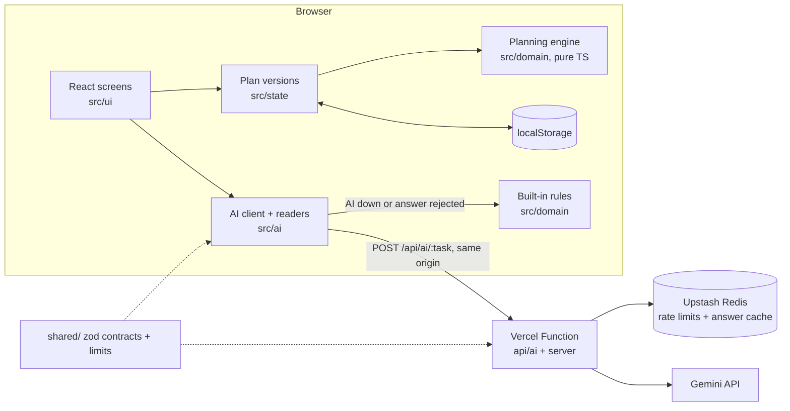

# Bandobast: plans that hold when things change

**Bandobast** (Hindi/Urdu for "arrangements") is a GenAI planning assistant for Indian weddings, birthdays,
anniversaries and community events. It builds a budget, a timeline, vendor checklists and ideas for your guests.
When something changes, like more guests, a smaller budget, an earlier date or a new quote, it shows exactly what
moved and how to rebalance.

**Live app:** https://bandobast-event-planner.vercel.app · **Stack:** React 19, TypeScript, Vite, Vercel Functions, Gemini API,
Upstash Redis

> Gemini reads the messy text: change requests in English or Hinglish, pasted vendor quotes, free-text event
> descriptions. It also writes ideas and plain-language comparisons. Code does every calculation and checks every AI
> answer before it is shown. When the AI is unavailable, built-in rules take over, and the app always says which of
> the two read your text.

## Quality at a glance

| Area          | In short                                                                                                                                                    | Details                                                            |
| ------------- | ----------------------------------------------------------------------------------------------------------------------------------------------------------- | ------------------------------------------------------------------ |
| Problem fit   | Budgets, timelines, vendor checklists and personalised ideas for four event types, plus the Change Test and a quote checker                                 | [What the problem asks](#what-the-problem-asks-and-where-it-lives) |
| Code quality  | Strict TypeScript with no `any`, a pure planning engine, zod contracts shared by browser and server. Lint enforces complexity ≤ 8 and functions ≤ 50 lines. | [Architecture](#architecture), [decisions](docs/decisions.md)      |
| Security      | Server-only key, request checks before parsing, schemas both ways, rate limits in a shared store that fail closed, strict CSP                               | [Security](#security), [SECURITY.md](SECURITY.md)                  |
| Efficiency    | AI only on request, a 24-hour answer cache, one time budget per request, about 131 kB of gzipped JavaScript                                                 | [Efficiency](#efficiency)                                          |
| Testing       | Unit, property, component and browser tests, 99.7% line coverage, run in CI                                                                                 | [Testing](#testing), [claims](#claims-you-can-check)               |
| Accessibility | WCAG 2.2 AA: no axe violations on any screen, keyboard tabs, managed focus, live regions                                                                    | [Accessibility](#accessibility-wcag-22-aa)                         |

## The Change Test: a 30-second demo

1. Open the app and choose **Try the sample: Riya & Arjun's wedding, Pune** (200 guests, ₹12 lakh, 18 Feb 2027).
2. Click the example **"50 more guests, budget down 10%, event 2 weeks earlier"**, or type your own, for example
   _"50 log zyada, budget 10% kam"_. Then click **Check what this changes**. You see the three changes it read, each
   with the words it came from, and you confirm them.
3. The **What changed** report shows every budget line before and after, the reserve, the budget check
   (Fits → Short), tasks that became late, quote totals that changed, and up to three ways to rebalance, ranked by
   your own priorities. **Use this option** applies the fix to that same new version, so the change and its fix stay
   one step in History. **Undo this change** restores the old one.

Every version is kept in **History** (the last 30), with what each one changed and a one-click restore.

## What the problem asks, and where it lives

| The problem statement asks for            | What Bandobast does                                                                                                                                                                                                                                                                                                                               | Code                                                                             |
| ----------------------------------------- | ------------------------------------------------------------------------------------------------------------------------------------------------------------------------------------------------------------------------------------------------------------------------------------------------------------------------------------------------- | -------------------------------------------------------------------------------- |
| **Budgets**                               | Splits your total across the lines this event needs, scaled by guest count and format. The split always adds up to your total to the rupee, and keeps a reserve for surprises (8% for weddings). Every amount is labelled **Estimate**, **Your number**, **Quote** or **Booked**. When the money falls short, it offers ranked rebalance options. | [`budget.ts`](src/domain/budget.ts), [`scenarios.ts`](src/domain/scenarios.ts)   |
| **Timelines**                             | Tasks with dependencies, scheduled with the critical-path method: slack, late and tight tasks, and catch-up options with the biggest saving first. Each task has a Google Calendar link, and you can download an `.ics` file.                                                                                                                     | [`timeline.ts`](src/domain/timeline.ts), [`calendar.ts`](src/domain/calendar.ts) |
| **Vendor checklists**                     | A card per vendor: what to ask for at this guest count, questions to ask before booking, a status (to contact → contacted → quote received → booked) and a Google Maps search in your city.                                                                                                                                                       | [`vendors.ts`](src/domain/vendors.ts), [`catalog.ts`](src/domain/catalog.ts)     |
| **Personalised ideas**                    | A curated library ranked for your guests (elders, kids, diet, style), steerable (cheaper, more traditional, kid-friendly, elder-friendly, eco-friendly), plus fresh ideas from Gemini that pass code checks.                                                                                                                                      | [`ideas.ts`](src/domain/ideas.ts), [`ideaLibrary.ts`](src/domain/ideaLibrary.ts) |
| **Weddings, birthdays, community events** | Four event templates (wedding, birthday, anniversary, community), each with its own budget lines, tasks and dependencies.                                                                                                                                                                                                                         | [`templates/`](src/domain/templates)                                             |
| **GenAI-powered**                         | Five Gemini tasks, each with a schema, code checks and a rule-based fallback (next section).                                                                                                                                                                                                                                                      | [`server/tasks.ts`](server/tasks.ts), [`src/ai/readers.ts`](src/ai/readers.ts)   |

**Beyond the brief:** a **quote checker**. Paste a caterer's WhatsApp quote to get the real total for your guest
count (minimum guarantees, GST), lines that may add cost ("transport extra as per actuals"), questions to ask, and a
side-by-side comparison by worst-case total. A price that is not written in your text is never counted.

## How AI is used, and how its answers are checked

| Task      | Gemini reads or writes                                                | Code checks before anything is shown                                                                                            | Without the AI                          |
| --------- | --------------------------------------------------------------------- | ------------------------------------------------------------------------------------------------------------------------------- | --------------------------------------- |
| `change`  | A change request in English or Hinglish → typed changes               | Each change must quote its evidence from your words. Values are bounded and dates sane. You confirm before anything is applied. | Rule-based reader for the same phrasing |
| `quote`   | A pasted vendor quote → itemised lines, GST, minimum guarantee, notes | An amount counts only if that number is written in the quote. Notes must be copied from the text.                               | Line-by-line quote parser               |
| `intake`  | "Describe your event in your own words" → form fields                 | Only whitelisted, schema-valid fields are filled in, and you review the form                                                    | Rule-based field reader                 |
| `ideas`   | A profile summary (no names) → new ideas                              | No prices, contacts or business names. Categories must be known, "cheaper" must really be cheaper, and repeats are dropped.     | Curated library only                    |
| `explain` | Rebalance options → a short comparison                                | The model may only write `{{placeholders}}`. Code fills in every number, and text with digits is rejected.                      | Template sentence                       |

- **Models:** `gemini-3.5-flash-lite` first, then `gemini-3.8-flash` only if the first times out, errors or fails a
  check (a cheap-first cascade: on the live app the light model answered in about a second, and the larger one
  often ran past the 9-second per-model timeout). Both run through `@google/genai` with JSON-schema structured
  output, low thinking and temperature 1 (the Gemini 3 default, which Google advises keeping).
- **Prompting:** user text is fenced and labelled as data, never as instructions. Each task has its own system
  instruction ([`server/prompts.ts`](server/prompts.ts)) and an output token cap
  ([`server/config.ts`](server/config.ts)).
- **Cost and speed:** identical requests reuse a validated answer for 24 hours. The cache key is a one-way hash of
  the request, never the raw text.

## Architecture



- **One pure function makes the plan.** `buildPlan(input, today)` turns your inputs (profile, fixed amounts, task
  states, vendor statuses, quotes) into the budget, scenarios, schedule, vendor cards and quote analyses. Nothing
  that can be derived is stored. A version is just its inputs, so the diff between two versions is exact.
- **Money is integer paise** and dates are UTC day numbers, so there are no float or time-zone errors. Indian
  notation like `1.2 lakh`, `85k` or `₹2 crore` is parsed in [`money.ts`](src/domain/money.ts).
- **Contracts are shared.** The browser and the function validate the same zod schemas in [`shared/`](shared). Stored
  plans are validated on every load, and newer formats are set aside, not guessed at.
- **Expected failures are values, not exceptions** ([`result.ts`](src/domain/result.ts)). The AI function never
  throws to the client. Each error says whether the browser should fall back to its rules.

| Folder            | Holds                                                                                                            |
| ----------------- | ---------------------------------------------------------------------------------------------------------------- |
| `src/domain/`     | The planning engine: budget, scenarios, timeline, vendors, quotes, ideas, change reader, diff. No React, no I/O. |
| `src/state/`      | Reducer for versions, restore and undo; saving with a backup and an in-memory fallback                           |
| `src/ai/`         | Typed client for the function, plus readers that try Gemini first and then the rules                             |
| `src/ui/`         | Screens: welcome, intake, dashboard, the impact report and seven tabs                                            |
| `server/`, `api/` | The AI function: request checks, rate limits, cache, model chain, prompts, output checks                         |
| `shared/`         | zod contracts, input limits and the shared time budget                                                           |
| `e2e/`            | Playwright journeys with axe-core checks                                                                         |

## Security

- **The key stays on the server.** `GEMINI_API_KEY` exists only in the function's environment, never with a `VITE_`
  prefix. The CSP lets the page connect only to its own origin.
- **Checks before parsing:** POST only, JSON only, a same-site `Origin`, and a 16 KB body cap enforced while the body
  streams in ([`server/request.ts`](server/request.ts)). Then zod schemas for every input and every model answer,
  and the code checks listed above.
- **Rate limits in a shared store, not in memory:** 12 requests per 60 s and 200 a day per client, and 3,000 a day for the app, in
  Upstash Redis. If the store can't be reached, requests are refused. Clients are keyed by a salted SHA-256 hash of
  the platform-set IP, never the raw address.
- **Privacy:** phone numbers and e-mails are removed in the browser from every text sent to the AI (event
  description, change requests and quotes), and again on the server before a prompt is built. Ideas requests carry
  no names. Logs hold only the task, status, models tried and timing. Plans stay in your browser.
- **Output is data, never markup:** React escapes all text, there is no `dangerouslySetInnerHTML`, and links are
  built only from Google's URL formats. Headers in [`vercel.json`](vercel.json): strict CSP with no
  `unsafe-inline` or `unsafe-eval` (zod runs without its eval fast path), HSTS, `nosniff`, `X-Frame-Options: DENY`,
  `Referrer-Policy: no-referrer`, COOP/CORP, a locked-down Permissions-Policy. API answers are `no-store`.
  `vite preview` serves the same headers, so the browser tests run under the production CSP.
- **Supply chain:** exact versions with a lockfile, `npm audit` in CI, Actions pinned to commit SHAs, Dependabot.
  The threat model is in [SECURITY.md](SECURITY.md).

## Efficiency

- **AI only on request.** Planning, rebalancing, scheduling and diffs run in the browser in milliseconds. The
  engine's JSDoc notes the complexity of its functions.
- **One time budget per AI request:** the server answers within 20 s, the browser waits 23 s, and Vercel stops the
  function at 25 s. A single model call gets at most 9 s, so two models fit. A test checks these numbers against
  each other and against `vercel.json` ([`server/timing.test.ts`](server/timing.test.ts)).
- **Less work per answer:** a 24-hour answer cache, output token caps per task, low thinking, and requests from a
  screen you have left are cancelled.
- **Small, cacheable bundle:** about 131 kB of gzipped JavaScript in three chunks (app, React, zod), no UI framework,
  and hashed assets cached for a year. Saves are debounced, and flushed when the tab is hidden.
- **Close to the users:** the function runs in Mumbai (`bom1`), next to the Upstash database.

## Accessibility (WCAG 2.2 AA)

- **Structure:** a skip link, landmarks, one `h1` per screen and `lang="en-IN"`. Tables have captions and header
  scopes for the budget, quotes and diffs.
- **Focus:** focus moves to the new screen's heading, the change preview and the impact report. After an edit, a
  cancel or a quote action it stays on, or returns to, the part of the page you were using.
- **Keyboard:** WAI-ARIA tabs with arrow keys, Home and End. Every action is a real button or link, and focus is
  always visible.
- **Announcements:** live regions report AI progress and results, saves and quote actions. Form errors are listed
  in a summary that links to each field, with `aria-invalid` and `aria-describedby`.
- **Readable:** AA contrast, labels on every control, words for screen readers next to symbols (₹₹ cost levels),
  and reduced motion respected.
- **Tested:** axe-core finds no WCAG 2.2 A/AA violations on any screen in Playwright, on both desktop and mobile.
  `eslint-plugin-jsx-a11y` runs on every file, and component tests find elements by role and name.

## Testing

| Layer           | What                                                                                                                                                                | Where                  |
| --------------- | ------------------------------------------------------------------------------------------------------------------------------------------------------------------- | ---------------------- |
| Planning engine | Unit tests plus fast-check property tests. Examples: the budget split always adds up exactly; a delay never moves a task's predecessors.                            | `src/domain/*.test.ts` |
| AI function     | Every status path with a fake model, limiter and cache: 403, 405, 413, 415, 429, fail-closed 503, timeouts, invalid model JSON, cache poisoning, never logging text | `server/*.test.ts`     |
| Browser         | AI client and readers (AI first, then rules), the reducer and saving, and each tab with Testing Library, including focus and announcements                          | `src/**/*.test.ts(x)`  |
| Journeys        | The Change Test, the Gemini path, quotes, a new plan, the keyboard, axe, and no CSP violations under the production headers, on desktop and mobile                  | `e2e/plan.spec.ts`     |

Coverage thresholds are enforced in [`vite.config.ts`](vite.config.ts): 95% overall and 100% of lines for the planning
engine. Today: 339 unit and component tests, 99.7% of lines, 98% of branches, plus 14 browser runs. CI runs
everything on every push ([`.github/workflows/ci.yml`](.github/workflows/ci.yml)).

## Claims you can check

| Claim                                                                | Test                                                                                                                                                                           |
| -------------------------------------------------------------------- | ------------------------------------------------------------------------------------------------------------------------------------------------------------------------------ |
| The budget split adds up to your total to the rupee, for any input   | `src/domain/budget.test.ts`: "Σ planned + contingency === total" (property)                                                                                                    |
| A delay moves a task and its successors, never its predecessors      | `src/domain/timeline.test.ts`: "holds for any task and any delay (property)"                                                                                                   |
| A quote amount counts only if it is written in the quote             | `src/domain/grounding.test.ts`: "rejects amounts the text does not contain"                                                                                                    |
| A change from Gemini is dropped unless its evidence is in your words | `server/handler.test.ts`: "drops a change whose evidence is not in the request"                                                                                                |
| Explanations never contain numbers written by the model              | `server/handler.test.ts`: "answers 502 when an explanation contains digits"                                                                                                    |
| AI requests are refused when the rate-limit store is down            | `server/handler.test.ts`: "fails closed with 503 when the rate-limit store is unavailable"                                                                                     |
| The server answers before the browser and Vercel give up             | `server/timing.test.ts`: "lets the layers give up in order"                                                                                                                    |
| Request text is never logged                                         | `server/handler.test.ts`: "never logs the request text"                                                                                                                        |
| Hinglish change requests work without the AI                         | `src/domain/changeParser.test.ts`: "reads the same request in Hinglish"                                                                                                        |
| Phone numbers and e-mails are removed before text reaches the AI     | `src/ai/readers.test.ts`: "removes phone numbers and e-mails before sending"; `server/tasks.test.ts`: "strips fence tags in any case and removes contacts again on the server" |
| Every screen passes axe-core WCAG 2.2 AA, on desktop and mobile      | `e2e/plan.spec.ts`: "every screen passes an automated WCAG 2.2 AA check"                                                                                                       |
| The app runs under the production CSP with no violations             | `e2e/plan.spec.ts`: "the app runs under the production security headers with no violations"                                                                                    |
| The numbers in these docs match the code                             | `server/docs.test.ts`                                                                                                                                                          |

## Run locally

```bash
npm ci
npm run dev          # the app at http://localhost:5173 (AI features use the built-in rules)
npx vercel dev       # the app and the AI function together (needs the settings in .env.example)
npm run verify       # format, lint, types, unit tests with coverage, build
npm run e2e          # Playwright journeys (builds and serves the app)
```

Settings are server-only (Vercel → Settings → Environment Variables; template in [`.env.example`](.env.example)).
Without the first two, the function answers 503 and the app uses its rules.

| Setting                                              | Needed     | What it does                                                        |
| ---------------------------------------------------- | ---------- | ------------------------------------------------------------------- |
| `GEMINI_API_KEY`                                     | For the AI | The Gemini API key                                                  |
| `UPSTASH_REDIS_REST_URL`, `UPSTASH_REDIS_REST_TOKEN` | For the AI | Shared rate limits and the answer cache (`KV_REST_API_*` also work) |
| `GEMINI_MODELS`                                      | No         | Comma-separated model chain, tried in order (default as above)      |
| `RATE_LIMIT_SALT`                                    | No         | Salt for the one-way hash of client IPs used as rate-limit keys     |

## Known limitations

- Costs are planning estimates from typical mid-range assumptions, not vendor prices. Your own numbers and quotes
  replace them.
- Plans stay in this browser: there are no accounts and no sync across devices.
- The built-in rules understand common phrasing only. Anything they cannot read is listed, never guessed.

## Licence

© 2026 Shreekumar Shah. All rights reserved. The code is public for review and evaluation only. See [LICENSE](LICENSE).
