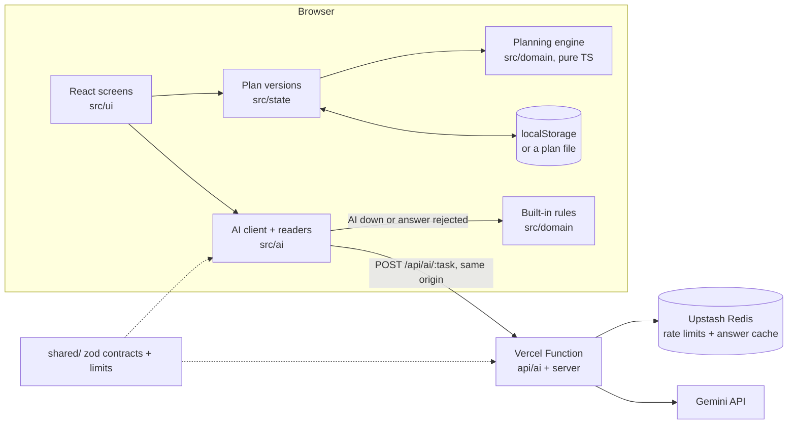

# Architecture

One idea shapes the code: **code decides, Gemini reads and writes.** A pure planning engine computes every number on screen. Gemini turns messy text into typed proposals and writes ideas and comparisons. Code checks each answer against the user's own words before it is shown, and built-in rules take over when the AI is unavailable.

## Layers

| Folder | Holds | May import |
| --- | --- | --- |
| `shared/` | zod contracts for plans and AI tasks, input limits, the shared time budget | zod only |
| `src/domain/` | The planning engine: budget, scenarios, timeline, vendors, quotes, ideas, change reader, diff, grounding checks | `shared/` |
| `src/state/` | Reducer for versions, restore and undo; saving with a backup and an in-memory fallback | `src/domain/`, `shared/` |
| `src/ai/` | Typed client for the function, plus readers that try Gemini first and then the rules | `src/domain/`, `shared/` |
| `src/ui/` | Screens: welcome, intake, dashboard, the impact report and seven tabs | the browser layers above |
| `server/`, `api/` | The AI function: request checks, rate limits, cache, model chain, prompts, output checks | `src/domain/` (grounding), `shared/` |
| `e2e/` | Playwright journeys with axe-core checks |  |

The last column is enforced: `no-restricted-imports` rules in [`eslint.config.js`](../eslint.config.js) fail the lint step if, for example, the engine imports React or the browser imports server code.

## How a change flows

1. The user types a change ("50 more guests, budget down 10%"). [`readChange`](../src/ai/readers.ts) sends it to the function, or reads it with the rule-based [`changeParser.ts`](../src/domain/changeParser.ts) when the AI is unavailable.
2. Each proposed change quotes its evidence. Code drops any change whose evidence is not in the request, and the user confirms what is left.
3. The reducer in [`planState.ts`](../src/state/planState.ts) stores a new version: the old inputs with the confirmed changes applied.
4. [`buildPlan(input, today)`](../src/domain/plan.ts) derives the budget, scenarios, schedule, vendor cards, quote analyses and payment totals from those inputs.
5. [`diff.ts`](../src/domain/diff.ts) compares the two derived plans, and the What changed report shows the result with ranked ways to rebalance.

The AI function's own steps (request checks, rate limit, cache, model cascade, output checks) are drawn in the README's [sequence diagram](../README.md#how-ai-is-used-and-how-its-answers-are-checked).

## Decision records

Each record gives the context, the decision and its consequences, including what it costs.

### ADR-001: One pure function makes the plan

- **Context.** Undo, restore, history and the What changed report all need two versions that can be compared exactly.
- **Decision.** Store only the user's inputs. `buildPlan(input, today)` derives everything else, and nothing that can be derived is stored.
- **Consequences.** A version is just its inputs, so undo, restore and the impact report are exact. The plan is rebuilt on every change. That takes well under a millisecond for this data, and the result is memoised.

### ADR-002: Code calculates, Gemini reads and writes

- **Context.** A planner that shows an invented price or a wrong total loses the user's trust, and model output can be wrong or injected.
- **Decision.** Gemini handles the language work: change requests, quotes, free-text intake, ideas and explanations. Every number on screen comes from the engine. Answers pass a zod schema and then code checks against the user's own text.
- **Consequences.** The checks reject some correct answers, and the rules then take over. We accept that in exchange for never showing an invented price.

### ADR-003: Every AI task has a rule-based fallback

- **Context.** The AI can be slow, rate-limited or switched off, and the planner must still work.
- **Decision.** The change reader, quote parser, intake reader, idea library and template explanation all work offline. The UI always says which one read the text.
- **Consequences.** Two readers per task, and both are tested.

### ADR-004: Money in integer paise, dates as UTC day numbers

- **Context.** Floating-point rupees drift, and local-time dates shift schedules across time zones.
- **Decision.** Amounts are integer paise and dates are UTC day numbers. The budget split uses largest-remainder rounding in ₹100 steps, and the reserve absorbs the difference.
- **Consequences.** The lines always add up to the total, which a property test checks for any input. Amounts become ₹ text only for display, in [`money.ts`](../src/domain/money.ts).

### ADR-005: Safeguards use a shared store, or they don't exist

- **Context.** Serverless instances don't share memory, so an in-memory rate limiter would only look like protection.
- **Decision.** Limits and the answer cache live in Upstash Redis. If the store is unreachable, AI requests are refused (fail closed).
- **Consequences.** Every AI request costs a store round trip, kept short by running the function in Mumbai next to the database. When the store is down, the app keeps working with its rules.

### ADR-006: One time budget per AI request

- **Context.** The browser, the function and Vercel each have a timeout. If they give up in the wrong order, the user waits for an answer that never comes.
- **Decision.** The server answers within 20 s, the browser waits 23 s, and Vercel stops the function at 25 s. Model attempts, store calls and the cache all fit inside that budget. The numbers live in `shared/timing.ts`.
- **Consequences.** The layers give up in a fixed order, so the user always gets an answer or a fallback. A test checks the numbers against each other and against `vercel.json`.

### ADR-007: Plans stay in the browser

- **Context.** Event plans hold names, dates and budgets, and accounts add personal data to protect.
- **Decision.** There are no accounts and no server database. Saves are validated on load, an unreadable save is set aside rather than overwritten, and if `localStorage` is blocked the app says so and keeps the plan in memory.
- **Consequences.** There are no stored personal data to breach. There is no automatic sync across devices: a plan file moves a plan by hand and passes the same checks as a save.

### ADR-008: A small dependency set

- **Context.** Every dependency adds bundle weight and supply-chain risk.
- **Decision.** React, zod, the Gemini SDK and the Upstash clients, with no UI framework or state library. Versions are exact and the lockfile is committed.
- **Consequences.** The production JavaScript is about 136 kB gzipped. Components and the tabs pattern are written by hand, so they need their own tests.

### ADR-009: Estimates follow the city's price level

- **Context.** The typical costs are mid-range metro prices, and a wedding in Jaipur or a smaller town costs less.
- **Decision.** Estimates scale by city class, after the X/Y/Z classes India uses for house-rent allowance: metros ×1, large cities ×0.85, everywhere else ×0.7, with NCR and Mumbai-region suburbs counted as their metro. The budget note states the class.
- **Consequences.** The factors are rough planning assumptions. Two towns in the same class get the same estimate, and the user's own numbers and quotes are never scaled.

## Where new code goes

- **A calculation:** a pure function in `src/domain/` with unit tests. The engine's 100% line-coverage threshold applies.
- **A new AI task:** a contract in [`shared/aiContracts.ts`](../shared/aiContracts.ts), a prompt in [`server/prompts.ts`](../server/prompts.ts), an output guard in [`server/tasks.ts`](../server/tasks.ts), a rule-based fallback in `src/domain/`, and a reader in [`src/ai/readers.ts`](../src/ai/readers.ts).
- **A new event type:** a template in [`src/domain/templates/`](../src/domain/templates) with its budget lines, tasks and dependencies.
- **A screen or tab:** a component in `src/ui/` that reads the plan through `PlanControls` and leaves every calculation to the engine.
